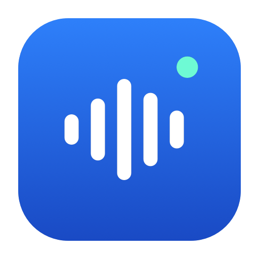
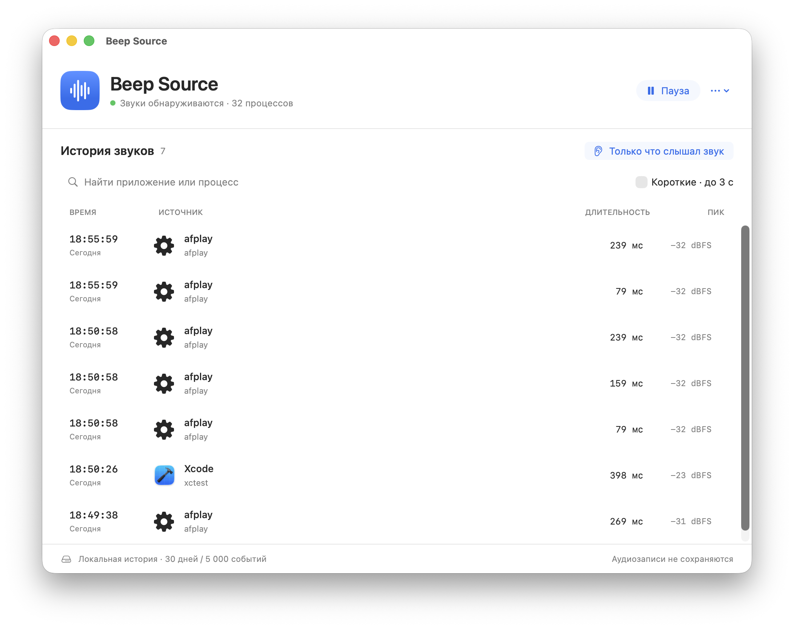

# Beep Source — find which Mac app is making a sound

**A free macOS menu bar app for tracking mystery beeps, notification sounds and other short audio.** Beep Source keeps a local sound history with the application or process, timestamp, duration and peak signal level. Hear a beep, open the history, and look at what just played.

**[Download Beep Source for Apple Silicon](https://github.com/globa-me/beep-source/releases/latest)** · **[Website](https://globa-me.github.io/beep-source/)** · [Русский](#русский)

Requires **macOS 14.2 or later** on **Apple Silicon**. The current app interface is **Russian**. The release is **Developer ID signed and notarized by Apple**, with the notarization ticket attached.



*Actual app screenshot. The `afplay` entries are short test sounds, not example claims about another application's behavior.*

## What it does

- Detects sound from applications and system processes using public Core Audio process taps.
- Shows when a sound started, how long it lasted, and its peak level in dBFS.
- Keeps running when you close the window; open it again from the waveform icon in the menu bar.
- Offers search, a short-sounds filter and “Только что слышал звук” (“I just heard a sound”), which shows the last 30 seconds and new events.
- Saves up to 30 days / 5,000 events locally, with CSV export, pause and optional launch at login.
- Processes signal levels without saving audio recordings. No microphone access, accounts or app network requests.

## Install and find a mystery beep

1. Download the ZIP from [Releases](https://github.com/globa-me/beep-source/releases/latest), extract it and move **Beep Source.app** into **Applications**.
2. Open the app and allow **system audio capture** when macOS asks. If needed, check **System Settings → Privacy & Security → Screen & System Audio Recording**, then restart monitoring from the **…** menu.
3. Close the window and carry on. After the unexplained sound, click the menu bar waveform and **“Только что слышал звук”**. Click a row for the process ID and details.

The release is signed with **Developer ID Application: Gennadiy Zakharov**, Team `BN3D9H4C7J`, using the G2 certificate chain. Apple notarization completed successfully, and the release includes the attached ticket. The packaged app passes signature verification and Gatekeeper assessment.

## Limits worth knowing

An audio session alone is not logged as a sound: the app measures actual digital samples above −65 dBFS. Adjacent fragments less than 220 ms apart are grouped. The level describes the digital signal, not the physical loudness of your speakers.

macOS may play notifications through a shared system process, hiding the original sender. Browser tabs cannot be identified. A new process can beep before its individual tap is ready; a global fallback records an unidentified sound when possible. An unknown beep overlapping music from a known app can be missed. Audio permissions, drivers and protected content may also limit detection.

History is stored in `~/Library/Application Support/Beep Source/history.json`. It contains event metadata, not recordings.

## Build from source

Install Xcode or its Command Line Tools with a recent macOS SDK, then:

```sh
git clone https://github.com/globa-me/beep-source.git
cd beep-source
./test.sh
BS_SIGN_IDENTITY=- ./build.sh
```

The locally built app appears in `.build/Beep Source.app`. For a Developer ID build, set `BS_SIGN_IDENTITY` to your own signing certificate's SHA-1 fingerprint. The script's default is the author's G2 certificate, which is not included in the repository.

See [DEVELOPMENT.md](DEVELOPMENT.md) for architecture, signing, real audio verification and development handoff. Report reproducible bugs in [Issues](https://github.com/globa-me/beep-source/issues).

## Русский

**Beep Source — бесплатная программа для macOS, которая помогает узнать, какое приложение издаёт непонятный звук.** Она работает в строке меню и сохраняет время, источник, длительность и уровень звукового сигнала.

[Скачать подписанную версию](https://github.com/globa-me/beep-source/releases/latest) · [Страница на русском](https://globa-me.github.io/beep-source/ru/)

Нужны **Apple Silicon и macOS 14.2+**. Интерфейс на русском. Переместите приложение в Applications, разрешите доступ к системному аудио и оставьте работать в фоне. После странного «бипа» откройте журнал через значок волны и нажмите **«Только что слышал звук»**. Доступны поиск, фильтр коротких звуков и экспорт CSV.

Аудиозаписи не сохраняются, сеть приложению не нужна. Некоторые системные уведомления видны только как общий процесс; точный источник каждого звука гарантировать нельзя. Приложение **подписано Developer ID через G2 и прошло нотариальную проверку Apple**. Нотариальный ticket включён в сборку.

Created by [Gennadiy Zakharov](https://github.com/globa-me). Free to download and use. Source licensing has not yet been selected.
